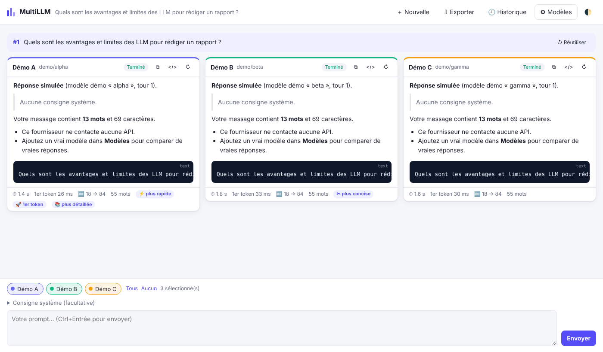

# MultiLLM

Plateforme de prompting multi-LLM : vous écrivez **un** prompt, il est envoyé **en parallèle** à plusieurs modèles (OpenAI, Claude, Gemini, Mistral, DeepSeek, Grok, Ollama…), et les réponses s'affichent **côte à côte**, en streaming, pour les comparer.



## Fonctionnalités

- **Interrogation parallèle** de tous les modèles sélectionnés, réponses en streaming.
- **Comparaison côte à côte** pour chaque tour : latence totale, délai avant le premier token, tokens entrée → sortie, nombre de mots, et badges automatiques (⚡ plus rapide, 🚀 premier token, ✂ plus concise, 📚 plus détaillée).
- **Conversations multi-tours** : chaque modèle garde son propre historique, les relances restent cohérentes.
- **Consigne système** commune, **relance** d'un modèle, **arrêt** global ou par modèle, copie, affichage brut / Markdown, réflexion (thinking) repliable quand le modèle l'expose.
- **Historique** des comparaisons (sauvegarde automatique) et **export Markdown**.
- **Gestion des modèles depuis l'interface** : ajout, modification, test de connexion, ordre, activation.
- **Clés API conservées côté serveur** (jamais renvoyées au navigateur), avec possibilité de les lire depuis des variables d'environnement.
- Thème clair / sombre, utilisable sur mobile.

## Démarrage

Prérequis : Node.js 18.17 ou plus récent.

```bash
npm install
npm start
```

Ouvrez ensuite <http://localhost:3000>. Deux modèles « Démo » (sans réseau) sont créés au premier lancement pour tester l'interface tout de suite.

## Ajouter un modèle

Cliquez sur **⚙ Modèles → ＋ Ajouter un modèle**, choisissez un fournisseur dans la liste « Modèle prédéfini » (les URL sont pré-remplies), collez votre clé API, indiquez l'identifiant du modèle, puis **Enregistrer**. Le bouton **Tester** vérifie la connexion.

| Fournisseur | Type d'API | URL de base |
|---|---|---|
| OpenAI | Compatible OpenAI | `https://api.openai.com/v1` |
| Anthropic (Claude) | Anthropic | *(par défaut)* — ex. `claude-opus-5-5` |
| Google Gemini | Google Gemini | `https://generativelanguage.googleapis.com/v1beta` |
| Mistral AI | Compatible OpenAI | `https://api.mistral.ai/v1` |
| DeepSeek | Compatible OpenAI | `https://api.deepseek.com/v1` |
| xAI (Grok) | Compatible OpenAI | `https://api.x.ai/v1` |
| Groq | Compatible OpenAI | `https://api.groq.com/openai/v1` |
| OpenRouter | Compatible OpenAI | `https://openrouter.ai/api/v1` |
| Perplexity | Compatible OpenAI | `https://api.perplexity.ai` |
| Together AI | Compatible OpenAI | `https://api.together.xyz/v1` |
| Ollama (local) | Compatible OpenAI | `http://localhost:11434/v1` |

Tout service qui expose une API `/chat/completions` compatible OpenAI fonctionne avec le type « Compatible OpenAI ».

Vous pouvez ajouter **plusieurs fois le même fournisseur** avec des modèles ou réglages différents (ex. deux températures, ou Claude avec et sans réflexion).

### Réglages par modèle

- **Température**, **tokens max** : laissés vides, le défaut du fournisseur s'applique. (Les modèles Claude récents n'acceptent plus la température : le champ est masqué.)
- **Réflexion** (Claude, Gemini) : « Afficher un résumé » montre le raisonnement du modèle dans un bloc repliable.
- **Effort** (Claude, modèles de raisonnement OpenAI) : `low` → `max`.
- **Repli automatique** (Claude Fable 5.1, Opus 5.5, Opus 5, Sonnet 5.5) : si le modèle refuse une demande, l'API Anthropic la rejoue sur un autre modèle ; la carte affiche alors quel modèle a réellement répondu. Décochez-le pour une comparaison stricte.
- **Paramètres supplémentaires** : un objet JSON fusionné tel quel dans la requête (ex. `{"top_p": 0.9}`, `{"response_format": {"type": "json_object"}}`).

### Clés API et sécurité

- Les clés sont enregistrées dans `data/models.json` (fichier ignoré par git, permissions `600`) et ne sont jamais renvoyées au navigateur (seuls les 4 derniers caractères sont affichés).
- Pour ne rien stocker sur disque, saisissez `env:NOM_VARIABLE` comme clé (ex. `env:OPENAI_API_KEY`) et définissez la variable dans `.env` (voir `.env.example`).
- Le serveur écoute par défaut sur `127.0.0.1` uniquement. Pour l'exposer sur le réseau, définissez `HOST=0.0.0.0` **et** `MULTILLM_PASSWORD`.

## Déploiement sur Netlify

Le dépôt est prêt pour Netlify (`netlify.toml`) :

- l'interface (`public/`) est servie en statique ;
- l'API est une fonction Netlify (`netlify/functions/api.mjs`, route `/api/*`) qui renvoie les réponses en streaming ;
- les modèles, clés et l'historique sont stockés dans **Netlify Blobs** (store `multillm`).

**Variable obligatoire** : `MULTILLM_PASSWORD` (Project configuration → Environment variables, portée *Functions*). Sans elle, l'API refuse de fonctionner, pour éviter que n'importe qui utilise vos clés. L'interface demande ce mot de passe à la première visite.

Variables facultatives : vos clés API (ex. `OPENAI_API_KEY`), à référencer dans l'interface avec `env:OPENAI_API_KEY`.

Limite à connaître : une fonction Netlify en streaming s'arrête après **60 secondes**. Pour des réponses très longues (modèles qui réfléchissent longtemps), réduisez les tokens max ou l'effort, ou utilisez la version locale.

## Architecture

```
server.js            serveur local (aucun framework) : fichiers statiques + API
lib/api.js           API REST + streaming NDJSON (Request → Response), partagée local / Netlify
lib/store.js         modèles et historique
lib/backend.js       stockage : fichiers JSON en local, Netlify Blobs en ligne
netlify/functions/   fonction Netlify qui expose lib/api.js
lib/sse.js           lecture des flux Server-Sent Events
providers/
  openai.js          API compatibles OpenAI (Chat Completions)
  anthropic.js       Claude, via le SDK officiel @anthropic-ai/sdk
  gemini.js          Google Gemini (streamGenerateContent)
  demo.js            modèle simulé, sans réseau
public/              interface web (HTML/CSS/JS sans build)
test/                tests des adaptateurs contre de faux serveurs locaux
```

Le navigateur lance une requête `POST /api/chat` **par modèle**, simultanément ; le serveur relaie chacune vers le bon fournisseur et renvoie la réponse au fil de l'eau. Ajouter un nouveau type d'API revient à écrire un adaptateur dans `providers/` (un générateur asynchrone qui émet des événements `text`, `usage`, `stop`…).

## Tests

```bash
npm test
```
